```{=latex}
\begin{titlepage}
\centering
\vspace*{30mm}
{\sffamily\bfseries\LARGE Отчет по лабораторной работе №1:\par}
\vspace{5mm}
{\sffamily\bfseries\Large Полнодоступная двухсервисная модель Эрланга с одинаковыми интенсивностями обслуживания\par}
\vspace{8mm}
{\sffamily\bfseries Дисциплина: Основы проектирования сетей и систем телекоммуникаций\par}
\vspace{15mm}
{\large Выполнил: Кхари Жекка Кализая Арсе, НПИбд-01-23\par}
\end{titlepage}
\tableofcontents
\clearpage

```

# цель

Смоделировать перегрузку сети, обслуживающей два сервиса без очереди.

# Численный анализ

Для моделирования этого сценария сначала были подготовлены исходные данные:

- C: пиковая пропускная способность соты
- $\lambda_1$ и $\lambda_2$: интенсивность поступления запросов на предоставление услуги 1, 2-го типа \[запросов/ед.вр.\];
- U: среднее время обслуживания запроса на предоставление услуги 1, 2-го тип \[запросов/ед.вр.\];

Остальные данные будут вычислены и занесены в таблицу, представленную на @fig-01.


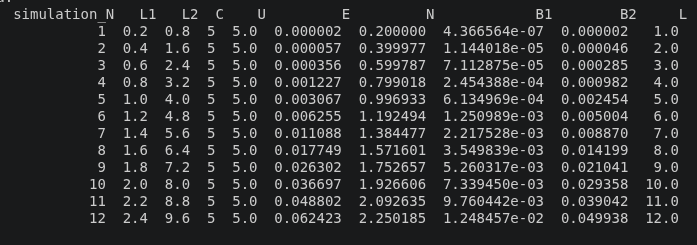{#fig-01 width=90% fig-pos=H}

Алгоритм состоит из двух основных функций: netSimulator и functionPn.

- netSimulator @fig-02: предназначена для работы с переменной data, которая содержит минимально необходимую информацию для вычисления:
  - E (Вероятность блокировки по времени)
  - P_{n..c} (Распределение вероятностей состояний системы)
  - N (Среднее число обслуживаемых в системе запросов)
  - B_{1,2} Вероятность блокировки по вызовам для услуг


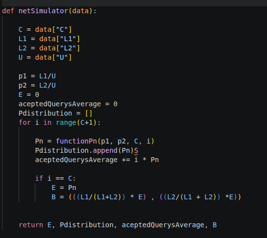{#fig-02 width=90% fig-pos=H}

- functionPn @fig-03: разработана как вспомогательная функция для netSimulator. Она вычисляет сумму в формуле
$p_n =\left(\sum_{i=0}^{C}\frac{(\rho_1 + \rho_2)^i}{i!}\right)^{-1}\cdot \frac{(\rho_1 + \rho_2)^n}{n!}$
и принимает значения p1 и p2 (интенсивность предложеннойнагрузки предоставление услуги 1, 2-го типа), C и N.

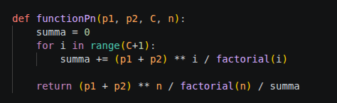{#fig-03 width=90% fig-pos=H}

- функция drawPlot @fig-07: предназначена для построения графика зависимости вероятности блокировки от интенсивности поступления запросов на обслуживание и графика зависимости среднего числа обслуживаемых запросов от интенсивности поступления запросов на предоставление услуги.

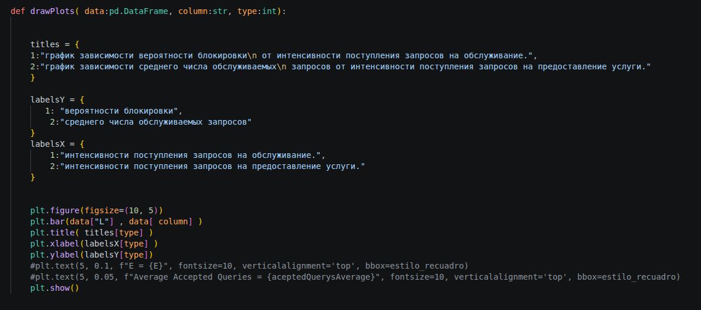{#fig-07 width=90% fig-pos=H}

- главная функция: выполняет операции ввода с клавиатуры, чтобы пользователь мог вручную ввести минимально необходимые значения для запуска моделирования, вызвать описанные выше функции, сохранить данные и вывести их в консоль.

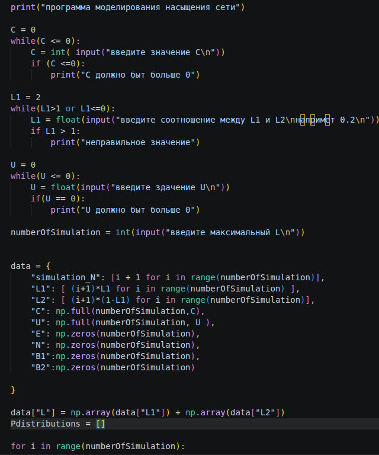{}
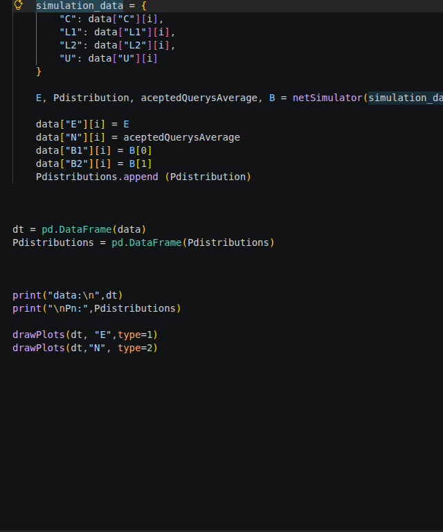{}


## Пошаговая работа алгоритма

Как указано в задании к лабораторной работе № 1, будут использоваться следующие основные формулы:

$\rho_i = \frac{\lambda_i}{\mu}$

$p_n =\left(\sum_{i=0}^{C}\frac{(\rho_1 + \rho_2)^i}{i!}\right)^{-1}\cdot \frac{(\rho_1 + \rho_2)^n}{n!}$

$P_c = E$

$B_n$ = ${\lambda_n }\over {\lambda_1 + \lambda_2}$


$\bar{N} = \sum_{n \in X} n p_n$


1. Вычисляются $\rho_1$ и $\rho_2$. Поскольку они представляют нагрузку, их вычисление упрощается до $\lambda_n \over \mu$.

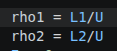{#fig-04 width=40% fig-pos=H}

2. Инициализируются переменные для хранения данных: Вероятность блокировки по времени (E), Среднее число обслуживаемых в системе запросов и Распределение вероятностей состояний системы (Pdistribution), а также aceptedQuerysAverage.

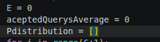{#fig-05 width=90% fig-pos=H}

3. Выполняется цикл for для вычисления всех $P_n$. Для этого вызывается функция functionPn() с соответствующими аргументами, после чего она вычисляет формулу, указанную в ее описании. На каждом шаге значение $P_i$ сохраняется в Pdistribution, а по формуле $\bar{N}$ вычисляется соответствующее Среднее число обслуживаемых в системе запросов. Когда i становится равным C, то есть $P_n = P_c$, это значение сохраняется в переменной E. Затем в кортеже B вычисляются и сохраняются значения $B_1$ и $B_2$. В итоге эти переменные возвращаются, записываются в таблицу данных, после чего начинается следующая симуляция с большим значением $\lambda$.

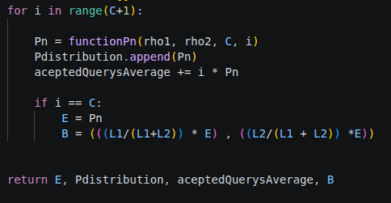{#fig-06 width=90% fig-pos=H}


<!--  {#fig-parametry width=90% fig-pos=H} -->

## пример работы

Выполним программу с начальными значениями:

C = 5, U = 0.5, L1/L2 = 0.2 и Lmax = 10


Для них были получены следующие результаты:


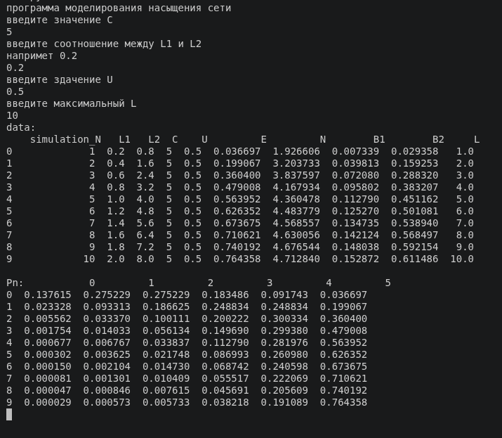{#fig-06 width=90% fig-pos=H}

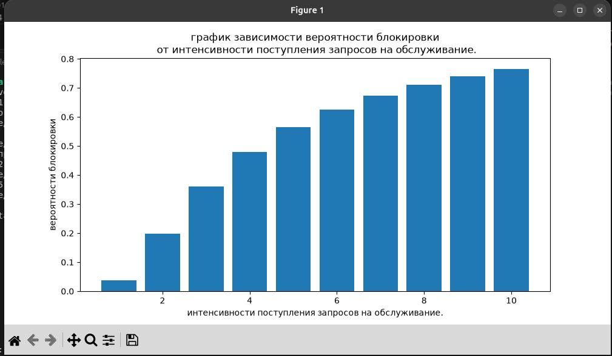{#fig-06 width=90% fig-pos=H}

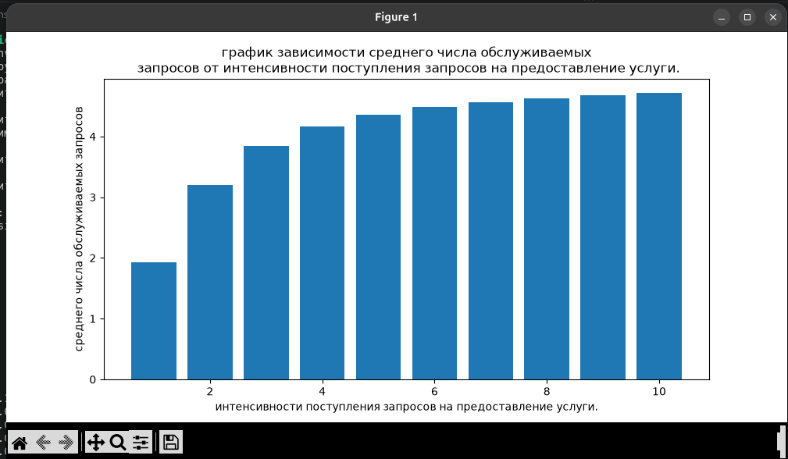{#fig-06 width=90% fig-pos=H}


# исходный код

```{python}


    from math import factorial
    import numpy as np
    import matplotlib.pyplot as plt
    import pandas as pd
    import argparse

    def functionPn(rho1, rho2, C, n):
        summa = 0
        for i in range(C+1):
            summa += (rho1 + rho2) ** i / factorial(i)

        return (rho1 + rho2) ** n / factorial(n) / summa

    def netSimulator(data):

        C = data["C"]
        L1 = data["L1"]
        L2 = data["L2"]
        U = data["U"]

        rho1 = L1/U
        rho2 = L2/U
        E = 0
        aceptedQuerysAverage = 0
        Pdistribution = []
        for i in range(C+1):

            Pn = functionPn(rho1, rho2, C, i)
            Pdistribution.append(Pn)
            aceptedQuerysAverage += i * Pn

            if i == C:
                E = Pn
                B = (((L1/(L1+L2)) * E) , ((L2/(L1 + L2)) *E))
            

        return E, Pdistribution, aceptedQuerysAverage, B

    def drawPlots( data:pd.DataFrame, column:str, type:int):


        titles = {
        1:"график зависимости вероятности блокировки\n от интенсивности поступления запросов на обслуживание.",
        2:"график зависимости среднего числа обслуживаемых\n запросов от интенсивности поступления запросов на предоставление услуги."
        }

        labelsY = {
          1: "вероятности блокировки",
            2:"среднего числа обслуживаемых запросов"
        }
        labelsX = {
            1:"интенсивности поступления запросов на обслуживание.",
            2:"интенсивности поступления запросов на предоставление услуги."
        }

        
        plt.figure(figsize=(10, 5))
        plt.bar(data["L"] , data[ column] )
        plt.title( titles[type] )
        plt.xlabel(labelsX[type] )
        plt.ylabel(labelsY[type])
        #plt.text(5, 0.1, f"E = {E}", fontsize=10, verticalalignment='top', bbox=estilo_recuadro)
        #plt.text(5, 0.05, f"Average Accepted Queries = {aceptedQuerysAverage}", fontsize=10, verticalalignment='top', bbox=estilo_recuadro)
        plt.show()


    #E, Pdistribution, aceptedQuerysAverage = netSimulator(10, 5, 3, 20)

    print("программа моделирования насыщения сети")

    C = 0
    while(C <= 0):
        C = int( input("введите значение C\n"))
        if (C <=0):
            print("C должно быт больше 0")

    L1 = 2
    while(L1>1 or L1<=0):
        L1 = float(input("введите соотношение между L1 и L2\nнапримет 0.2\n"))
        if L1 > 1: 
            print("неправильное значение")

    U = 0
    while(U <= 0):
        U = float(input("введите здачение U\n"))
        if(U == 0):
            print("U должно быт больше 0")

    numberOfSimulation = int(input("введите максимальный L\n"))


    data = {
        "simulation_N": [i + 1 for i in range(numberOfSimulation)],
        "L1": [ (i+1)*L1 for i in range(numberOfSimulation) ],
        "L2": [ (i+1)*(1-L1) for i in range(numberOfSimulation)],
        "C": np.full(numberOfSimulation,C),
        "U": np.full(numberOfSimulation, U ),
        "E": np.zeros(numberOfSimulation),
        "N": np.zeros(numberOfSimulation),
        "B1":np.zeros(numberOfSimulation),
        "B2":np.zeros(numberOfSimulation)

    }

    data["L"] = np.array(data["L1"]) + np.array(data["L2"])
    Pdistributions = []

    for i in range(numberOfSimulation):
        simulation_data = {
            "C": data["C"][i],
            "L1": data["L1"][i],
            "L2": data["L2"][i],
            "U": data["U"][i]
        }

        E, Pdistribution, aceptedQuerysAverage, B = netSimulator(simulation_data)

        data["E"][i] = E
        data["N"][i] = aceptedQuerysAverage
        data["B1"][i] = B[0]
        data["B2"][i] = B[1]
        Pdistributions.append (Pdistribution)
        


    dt = pd.DataFrame(data)
    Pdistributions = pd.DataFrame(Pdistributions)


    print("data:\n",dt)
    print("\nPn:",Pdistributions)

    drawPlots(dt, "E",type=1)
    drawPlots(dt,"N", type=2)


```