```{=latex}
\begin{titlepage}
\centering
\vspace*{30mm}
{\sffamily\bfseries\LARGE Отчет по лабораторной работе №1:\par}
\vspace{5mm}
{\sffamily\bfseries\Large Полнодоступная двухсервисная модель Эрланга с одинаковыми интенсивностями обслуживания\par}
\vspace{8mm}
{\sffamily\bfseries Дисциплина: Основы проектирования сетей и систем телекоммуникаций\par}
\vspace{15mm}
{\large Выполнил: Кхари Жекка Кализая Арсе, НПИбд-01-23\par}
\end{titlepage}
\tableofcontents
\clearpage

```


# алгоритм расчета вероятностных характеристик модели

1. читать/вводить/загрузить в памяти исходные данные 
2. расcчитать интенсивность предложенной нагрузки $\rho_1$  $\rho_2$ 
3. рассчитать первую вероятность $P_0$
4. рассчитать все вероятности $P_n$ (с $P_0$ до $P_c$)
5. проверять: 
$\sum_{n=0}^{C}p_n=1$
6. рассчитать вероятность блокировки $E_1$:  
      $E_1=p_C$


7. рассчитать вероятность блокировки $E_2$: 

      $E_2=\sum_{n=g}^{C}p_n$

8. рассчитать средное число заявок
9. показывать результаты


# Численный анализ

Для расчёта основных вероятностных характеристик модели были взяты [следующие параметры](#eq-input).

$$ 
C = 10, g = 3, \lambda_1 = 20, \lambda_2 = 30, \mu = 0.5
$$ {#eq-input}

Код написане на языке Python и выполнен в среде Visual Studio Code.

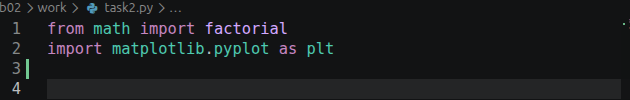{#fig-01 width=90% fig-pos=H}

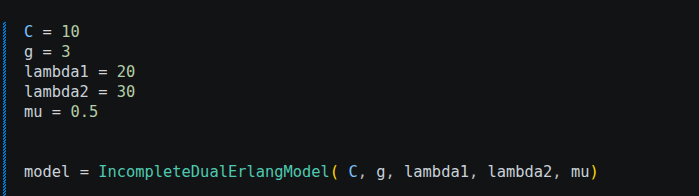{#fig-02 width=90% fig-pos=H}

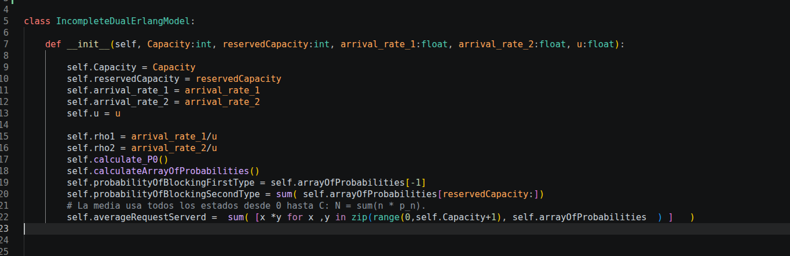{#fig-03 width=90% fig-pos=H}

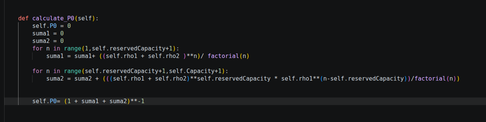{#fig-04 width=90% fig-pos=H}

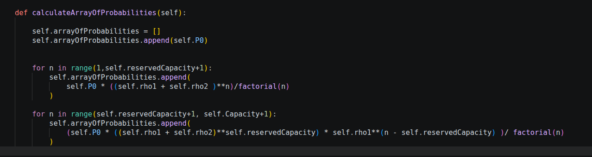{#fig-05 width=90% fig-pos=H}

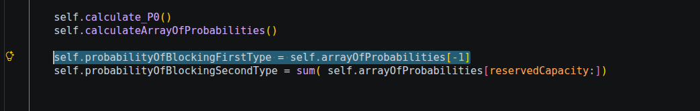{#fig-06 width=90% fig-pos=H}

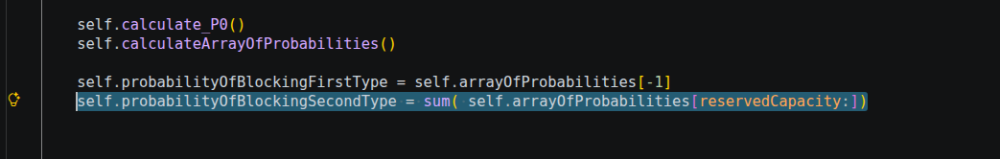{#fig-07 width=90% fig-pos=H}

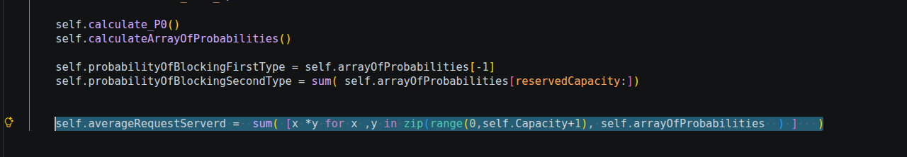{#fig-08 width=90% fig-pos=H}

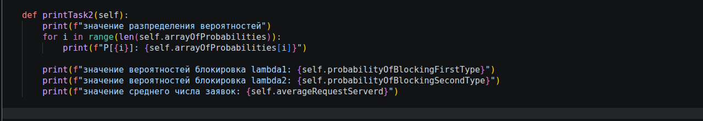{#fig-09 width=90% fig-pos=H}

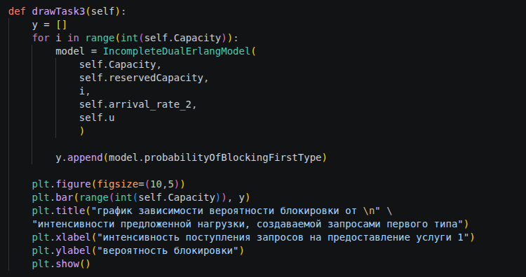{#fig-10 width=90% fig-pos=H}

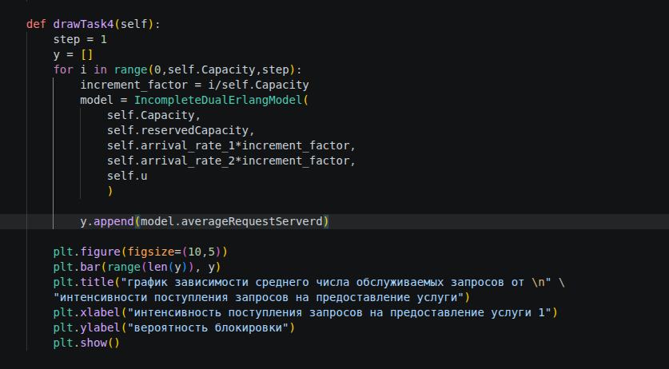{#fig-11 width=90% fig-pos=H}

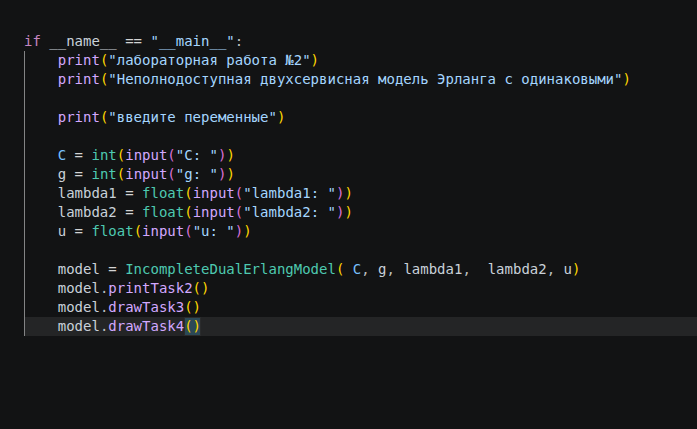{#fig-12 width=90% fig-pos=H}


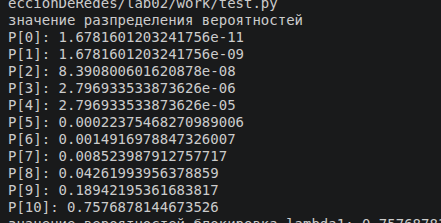{#fig-13 width=90% fig-pos=H}

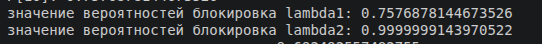{#fig-14 width=90% fig-pos=H}

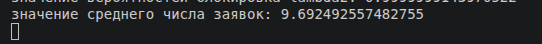{#fig-15 width=90% fig-pos=H}

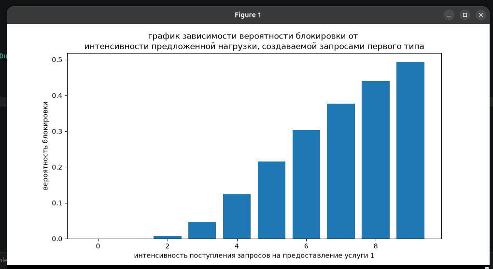{#fig-16 width=90% fig-pos=H}

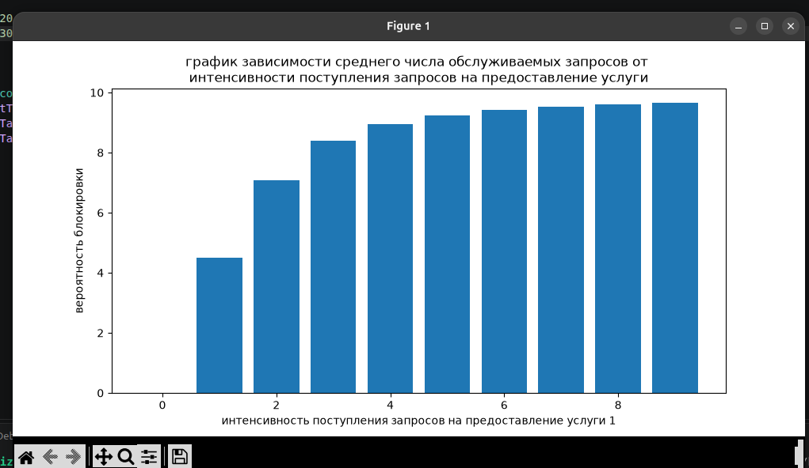{#fig-17 width=90% fig-pos=H}


# исходный код


## lab02_task.py

```python
from math import factorial
import matplotlib.pyplot as plt


class IncompleteDualErlangModel:

    def __init__(
            self, 
            Capacity:int, 
            reservedCapacity:int, 
            arrival_rate_1:float, 
            arrival_rate_2:float, 
            u:float
            ):

        self.Capacity = Capacity
        self.reservedCapacity = reservedCapacity
        self.arrival_rate_1 = arrival_rate_1
        self.arrival_rate_2 = arrival_rate_2
        self.u = u

        self.rho1 = arrival_rate_1/u
        self.rho2 = arrival_rate_2/u

        self.calculate_P0()
        self.calculateArrayOfProbabilities()

        self.probabilityOfBlockingFirstType = self.arrayOfProbabilities[-1]
        self.probabilityOfBlockingSecondType = sum( self.arrayOfProbabilities[reservedCapacity:])


        self.averageRequestServerd =  sum( [x *y for x ,y in zip(range(0,self.Capacity+1), self.arrayOfProbabilities  ) ]   )


    def calculate_P0(self):
        self.P0 = 0
        suma1 = 0 
        suma2 = 0
        for n in range(1,self.reservedCapacity+1):
            suma1 = suma1+ ((self.rho1 + self.rho2 )**n)/ factorial(n)

        for n in range(self.reservedCapacity+1,self.Capacity+1):
            suma2 = suma2 + (((self.rho1 + self.rho2)**self.reservedCapacity * self.rho1**(n-self.reservedCapacity))/factorial(n))
        
        
        self.P0= (1 + suma1 + suma2)**-1


    def calculateArrayOfProbabilities(self):
        
        self.arrayOfProbabilities = []
        self.arrayOfProbabilities.append(self.P0)
        

        for n in range(1,self.reservedCapacity+1):
            self.arrayOfProbabilities.append(  
                self.P0 * ((self.rho1 + self.rho2 )**n)/factorial(n) 
            )

        for n in range(self.reservedCapacity+1, self.Capacity+1):
            self.arrayOfProbabilities.append( 
                (self.P0 * ((self.rho1 + self.rho2)**self.reservedCapacity) * self.rho1**(n - self.reservedCapacity) )/ factorial(n)
            )


    def printTask2(self):
        print(f"значение разпределения вероятностей")
        for i in range(len(self.arrayOfProbabilities)):
            print(f"P[{i}]: {self.arrayOfProbabilities[i]}")

        print(f"значение вероятностей блокировка lambda1: {self.probabilityOfBlockingFirstType}")
        print(f"значение вероятностей блокировка lambda2: {self.probabilityOfBlockingSecondType}")
        print(f"значение среднего числа заявок: {self.averageRequestServerd}")                


    def drawTask3(self):
        y = []
        for i in range(int(self.Capacity)):
            model = IncompleteDualErlangModel(
                self.Capacity, 
                self.reservedCapacity, 
                i, 
                self.arrival_rate_2, 
                self.u 
                )
            
            y.append(model.probabilityOfBlockingFirstType)
        
        plt.figure(figsize=(10,5))
        plt.bar(range(int(self.Capacity)), y)
        plt.title("график зависимости вероятности блокировки от \n" \
        "интенсивности предложенной нагрузки, создаваемой запросами первого типа")
        plt.xlabel("интенсивность поступления запросов на предоставление услуги 1")
        plt.ylabel("вероятность блокировки")
        plt.show()

    def drawTask4(self):
        step = 1
        y = []
        for i in range(0,self.Capacity,step):
            increment_factor = i/self.Capacity
            model = IncompleteDualErlangModel(
                self.Capacity, 
                self.reservedCapacity, 
                self.arrival_rate_1*increment_factor, 
                self.arrival_rate_2*increment_factor, 
                self.u 
                )
            
            y.append(model.averageRequestServerd)
        
        plt.figure(figsize=(10,5))
        plt.bar(range(len(y)), y)
        plt.title("график зависимости среднего числа обслуживаемых запросов от \n" \
        "интенсивности поступления запросов на предоставление услуги")
        plt.xlabel("интенсивность поступления запросов на предоставление услуги 1")
        plt.ylabel("вероятность блокировки")
        plt.show()


if __name__ == "__main__":
    print("лабораторная работа №2")
    print("Неполнодоступная двухсервисная модель Эрланга с одинаковыми")

    print("введите переменные")

    C = int(input("C: "))
    g = int(input("g: "))
    lambda1 = float(input("lambda1: "))
    lambda2 = float(input("lambda2: "))
    u = float(input("u: "))

    model = IncompleteDualErlangModel( C, g, lambda1,  lambda2, u)
    model.printTask2()
    model.drawTask3()
    model.drawTask4()

```

## test.py

```python
from lab02.work.lab02_task import IncompleteDualErlangModel

C = 10
g = 3
lambda1 = 20
lambda2 = 30
mu = 0.5


model = IncompleteDualErlangModel( C, g, lambda1, lambda2, mu)
model.printTask2()
model.drawTask3()
model.drawTask4()


```
<!--  {#fig-parametry width=90% fig-pos=H} -->


