```{=latex}
\begin{titlepage}
\centering
\vspace*{30mm}
{\sffamily\bfseries\LARGE Отчет по лабораторной работе №1:\par}
\vspace{5mm}
{\sffamily\bfseries\Large Полнодоступная двухсервисная модель Эрланга с одинаковыми интенсивностями обслуживания\par}
\vspace{8mm}
{\sffamily\bfseries Дисциплина: Основы проектирования сетей и систем телекоммуникаций\par}
\vspace{15mm}
{\large Выполнил: Кхари Жекка Кализая Арсе, НПИбд-01-23\par}
\end{titlepage}
\tableofcontents
\clearpage

```

# теоретическая часть


## Двухсервисная модель с эластичным трафиком

Проанализируем соту сети емкостью $C$. Пусть пользователи генерируют запросы на передачу данных двух типов. Запросы на передачу данных представляют собой ПП с интенсивностью $\lambda_i$, $i=1,2$. Средняя длина передаваемого файла $\theta_i$, $i=1,2$. Минимальная емкость, необходимая для передачи данных, равна $b_i$, $i=1,2$.

Основные обозначения (таблица 11.1 оригинала):

| Обозначение | Описание |
|:--|:--|
| $C$ | Пиковая пропускная способность соты. |
| $\lambda_i$, $i=1,2$ | Интенсивность поступления запросов на передачу данных первого/второго типа [запросов/ед.вр]. |
| $\theta_i$, $i=1,2$ | Длина передаваемого файла первого/второго типа [бит]. |
| $\rho_i^1$, $i=1,2$ | Интенсивность предложенной нагрузки, создаваемой запросами на передачу данных первого/второго типа. |
| $a_i$, $i=1,2$ | Доля нагрузки, создаваемой запросами на передачу данных первого/второго типа, которая приходится на единицу пропускной способности (безразмерная величина). |
| $b_i$, $i=1,2$ | Минимальное требование к ресурсам сети, необходимое для передачи данных первого/второго типа. |
| $X_i(t)$, $i=1,2$ | Число обслуживаемых в системе запросов на передачу данных первого/второго типа в момент времени $t$, $t\geq0$. |
| $X(t)=(X_1(t),X_2(t))$ | СП, описывающий функционирование системы в момент времени $t$, $t\geq0$. |
| $X$ | Пространство состояний системы. |
| $n_i$, $i=1,2$ | Число передаваемых в системе блоков данных первого/второго типа. |
| $B_i$, $i=1,2$ | Множество блокировок запросов на передачу данных первого/второго типа. |
| $S_i$, $i=1,2$ | Множество приема запросов на передачу данных первого/второго типа. |

## Схема модели

Схема модели (рис. 11.1 оригинала):

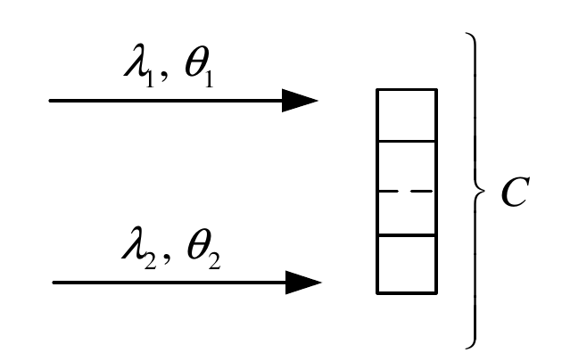{width=45% fig-pos="H" fig-alt="Схема двухсервисной модели с эластичным трафиком"}

Рис. 11.1. Схема двухсервисной модели с эластичным трафиком.

Пространство состояний системы (рис. 11.2 в тексте оригинала):

$$
X=\{(n_1,n_2):n_1\geq0,\ n_2\geq0\}. \tag{11.1}
$$

Рассмотрим некоторое центральное состояние $(n_1,n_2)\in X$. Построим диаграмму интенсивностей переходов для центрального состояния (рис. 11.3):

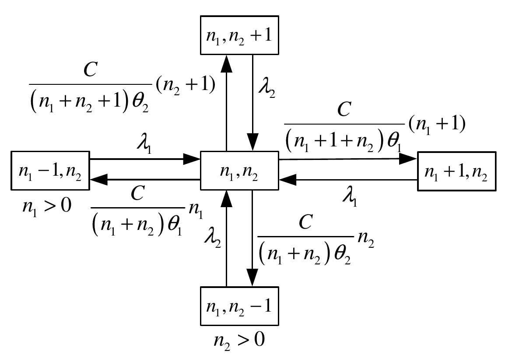{width=90% fig-pos="H" fig-alt="Диаграмма интенсивностей переходов для центрального состояния"}

Рис. 11.3. Диаграмма интенсивностей переходов для центрального состояния двухсервисной модели с эластичным трафиком.

Пояснения:

- $\dfrac{C}{n_1+n_2}$ — скорость передачи данных первого/второго типа в состоянии $(n_1,n_2)$.
- $\dfrac{\theta_1}{C/(n_1+n_2)}=\dfrac{\theta_1}{C}(n_1+n_2)$ — среднее время обслуживания запроса на передачу данных первого типа в состоянии $(n_1,n_2)$.
- $\dfrac{\theta_2}{C/(n_1+n_2)}=\dfrac{\theta_2}{C}(n_1+n_2)$ — среднее время обслуживания запроса на передачу данных второго типа в состоянии $(n_1,n_2)$.
- $\dfrac{C}{\theta_1(n_1+n_2)}$ — интенсивность обслуживания запроса на передачу данных первого типа в состоянии $(n_1,n_2)$.
- $\dfrac{C}{\theta_2(n_1+n_2)}$ — интенсивность обслуживания запроса на передачу данных второго типа в состоянии $(n_1,n_2)$.

Множество блокировок запросов на передачу данных:

$$
B_i=\{\varnothing\},\quad i=1,2. \tag{11.2}
$$

Множество приема запросов на передачу данных:

$$
S_i=\overline{B_i}=X\setminus B_i=\{0,1,2,\ldots\},\quad i=1,2. \tag{11.3}
$$

## Система уравнений глобального баланса

Система уравнений глобального баланса (СУГБ):

$$
\begin{aligned}
&\left(\lambda_1+\lambda_2+
\frac{Cn_1}{(n_1+n_2)\theta_1}+
\frac{Cn_2}{(n_1+n_2)\theta_2}\right)p(n_1,n_2)\\
&\quad=\lambda_1p(n_1-1,n_2)U(n_1)
+\lambda_2p(n_1,n_2-1)U(n_2)\\
&\qquad+\frac{C(n_1+1)}{(n_1+1+n_2)\theta_1}p(n_1+1,n_2)\\
&\qquad+\frac{C(n_2+1)}{(n_1+n_2+1)\theta_2}p(n_1,n_2+1),
\quad(n_1,n_2)\in X.
\end{aligned}\tag{11.4}
$$

## Критерий Колмогорова

Чтобы выписать систему уравнений частичного баланса (СУЧБ), проверим критерий Колмогорова. Рассмотрим произвольный замкнутый контур (рис. 11.4):

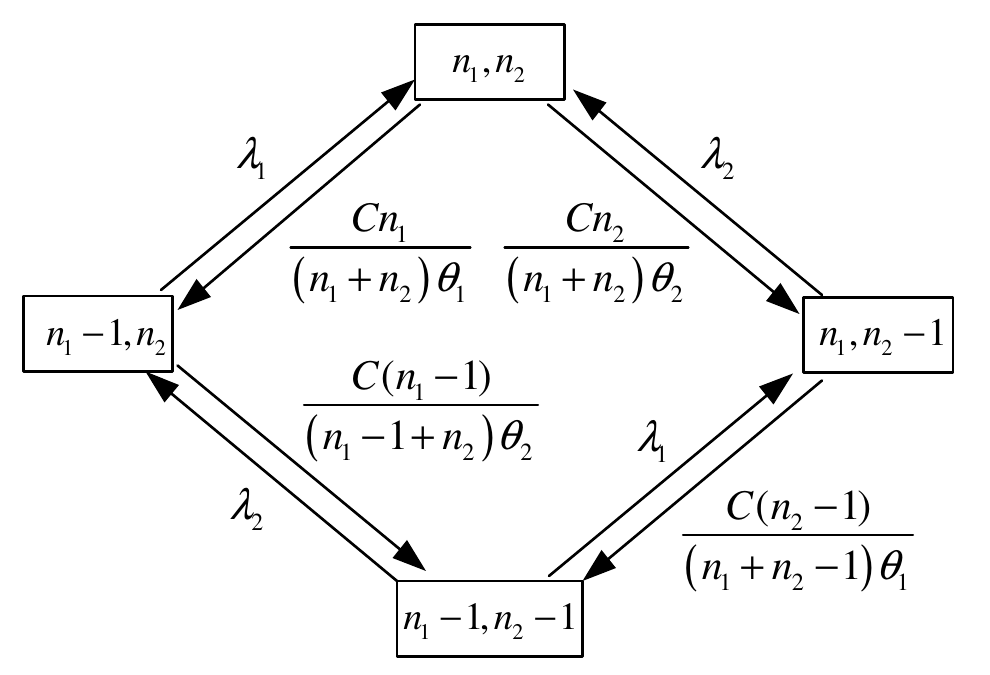{width=80% fig-pos="H" fig-alt="Произвольный замкнутый контур для двухсервисной модели"}

Рис. 11.4. Произвольный замкнутый контур для двухсервисной модели с эластичным трафиком.

Рассмотрим произведение интенсивностей переходов:

- По часовой стрелке:

$$
\frac{n_2}{n_1+n_2}\frac{C}{\theta_2}
\frac{n_1}{n_1+n_2-1}\frac{C}{\theta_1}\lambda_1\lambda_2.
$$

- Против часовой стрелки:

$$
\frac{n_1}{n_1+n_2}\frac{C}{\theta_1}
\frac{n_2}{n_1+n_2-1}\frac{C}{\theta_2}\lambda_1\lambda_2.
$$

Произведения равны. Критерий выполнен, следовательно, СП $(X_1(t),X_2(t))$, описывающий поведение системы, является обратимым марковским процессом, СУЧБ существует.

## Система уравнений частичного баланса

$$
\begin{cases}
p(n_1,n_2)\dfrac{Cn_1}{(n_1+n_2)\theta_1}
=\lambda_1p(n_1-1,n_2),& n_1>0,\\[6pt]
p(n_1,n_2)\dfrac{Cn_2}{(n_1+n_2)\theta_2}
=\lambda_2p(n_1,n_2-1),& n_2>0,
\end{cases}
\quad(n_1,n_2)\in X.\tag{11.5}
$$

Обозначим $\rho_i=\lambda_i\theta_i$, $a_i=\rho_i/C$, $\rho_i<C$, $i=1,2$.

Стационарное распределение вероятностей состояний системы:

$$
p(n_1,n_2)=\frac{a_1^{n_1}a_2^{n_2}}{n_1!\,n_2!}
(n_1+n_2)!\,p(0,0),\tag{11.6}
$$

где

$$
p(0,0)=\left(
\sum_{(n_1,n_2)\in X}(n_1+n_2)!
\frac{a_1^{n_1}a_2^{n_2}}{n_1!\,n_2!}
\right)^{-1}.\tag{11.7}
$$

## Основные вероятностные характеристики модели

Вероятность блокировки по времени $E_i$, $i=1,2$, запроса на передачу данных первого/второго типа:

$$
E_1=E_2=0.\tag{11.8}
$$

Среднее число $\overline N_i$, $i=1,2$, обслуживаемых в системе запросов на передачу данных первого/второго типа:

$$
\overline N_i=\lambda_i\frac{\theta_i}{\theta_1\lambda_1+\theta_2\lambda_2},
\quad i=1,2.\tag{11.9}
$$

Среднее время $T_i$, $i=1,2$, обслуживания запроса на передачу данных первого/второго типа:

$$
T_i=\frac{\overline N_i}{\lambda_i}.\tag{11.10}
$$


# Численный анализ

Для расчёта основных вероятностных характеристик модели были взяты [следующие параметры](#eq-input).

$$ 
C = 100, \lambda_1 = 30, \lambda_2 = 20, theta1 = 1, theta2 = 2
$$ {#eq-input}


Код написане на языке Python и выполнен в среде Visual Studio Code.


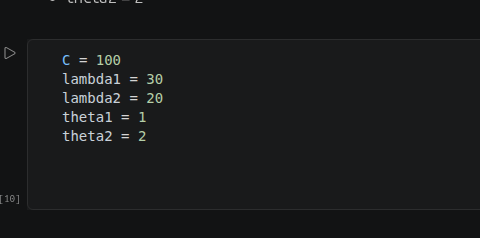{#fig-parametry width=90% fig-pos=H}

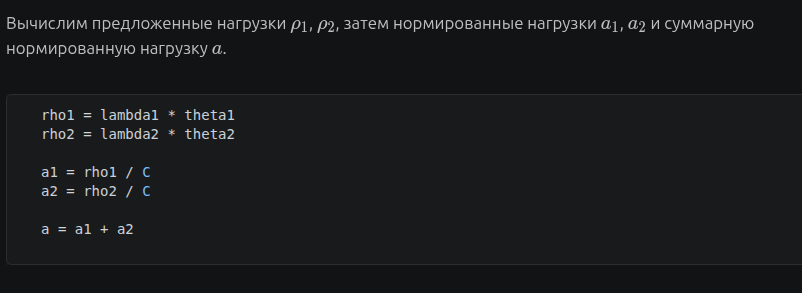{#fig-parametry width=90% fig-pos=H}

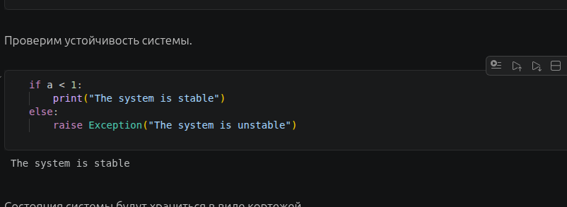{#fig-parametry width=90% fig-pos=H}

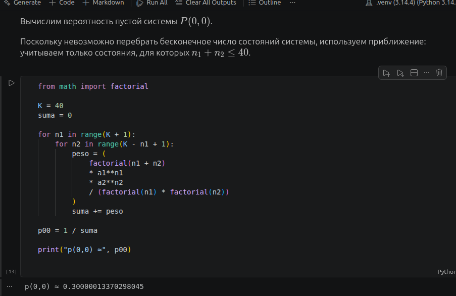{#fig-parametry width=90% fig-pos=H}

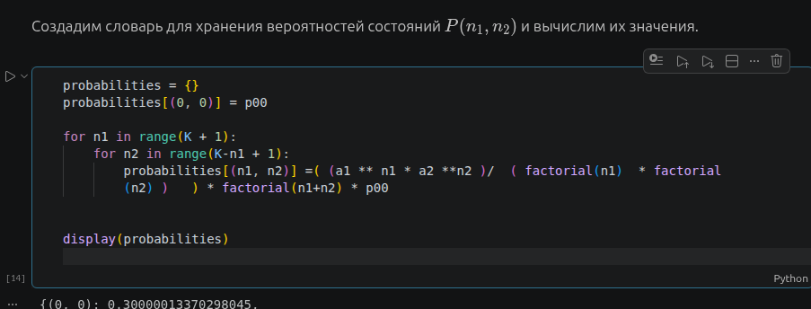{#fig-parametry width=90% fig-pos=H}

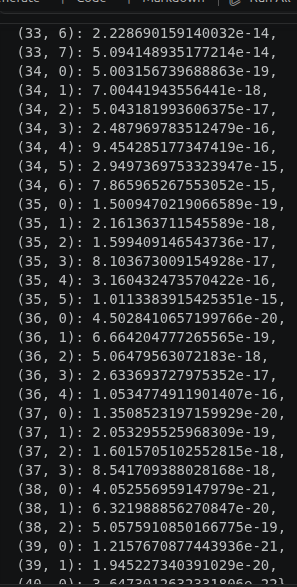{#fig-parametry width=90% fig-pos=H}

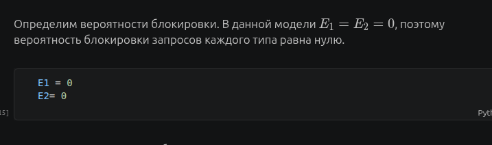{#fig-parametry width=90% fig-pos=H}

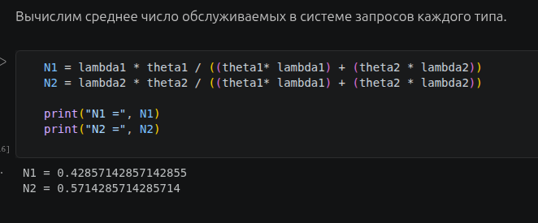{#fig-parametry width=90% fig-pos=H}

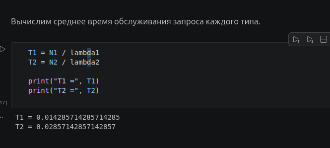{#fig-parametry width=90% fig-pos=H}

# код для решения задачи 2-4:

```python

import os


class Model:
    def __init__(self, C, lambda1, lambda2, theta1, theta2, *, silent=False):
        self.C = C
        self.lambda1 = lambda1
        self.lambda2 = lambda2
        self.theta1 = theta1
        self.theta2 = theta2

        self.rho1 = self.lambda1 * self.theta1
        self.rho2 = self.lambda2 * self.theta2
        self.a1 = self.rho1 / self.C
        self.a2 = self.rho2 / self.C
        self.a = self.a1 + self.a2

        
        if self.a < 1:
            if not silent:
                print("The system is stable")
        else:
            raise Exception("The system is unstable")

        from math import factorial

        K = 40
        suma = 0

        for n1 in range(K + 1):
            for n2 in range(K - n1 + 1):
                peso = (
                    factorial(n1 + n2)
                    * self.a1**n1
                    * self.a2**n2
                    / (factorial(n1) * factorial(n2))
                )
                suma += peso

        p00 = 1 / suma

        if not silent:
            print("p(0,0) ≈", p00)


        probabilities = {}
        probabilities[(0, 0)] = p00

        for n1 in range(K + 1):
            for n2 in range(K-n1 + 1):
                probabilities[(n1, n2)] =( (self.a1 ** n1 * self.a2 **n2 )/  ( factorial(n1)  * factorial(n2) )   ) * factorial(n1+n2) * p00
                if not silent:
                    print("p(", n1, ",", n2, ") =", probabilities[(n1, n2)])


        self.N1 = lambda1 * theta1 / ((theta1* lambda1) + (theta2 * lambda2))
        self.N2 = lambda2 * theta2 / ((theta1* lambda1) + (theta2 * lambda2))

        if not silent:
            print("\nСреднее число N_i")
        if not silent:
            print(" N1 =", self.N1)
        if not silent:
            print(" N2 =", self.N2)

        self.T1 = self.N1 / lambda1
        self.T2 = self.N2 / lambda2
        if not silent:
            print("\nСреднее время T_i")
        if not silent:
            print(" T1 =", self.T1)
        if not silent:
            print(" T2 =", self.T2)


def grafic_task3(C , lambda2, theta1, theta2):
    import matplotlib.pyplot as plt

    lambdas = []
    avg_time = []

    for lambda1 in range(1, 101):
        # Стационарные результаты существуют только при нагрузке ниже пропускной способности.
        if lambda1 * theta1 + lambda2 * theta2 >= C:
            continue

        model = Model(C, lambda1, lambda2, theta1, theta2, silent=True)
        lambdas.append(lambda1)
        avg_time.append((model.T1, model.T2))


    ancho = 0.4
    plt.bar([x - ancho / 2 for x in lambdas],
            [t[0] for t in avg_time], width=ancho, label="T1")
    plt.bar([x + ancho / 2 for x in lambdas],
            [t[1] for t in avg_time], width=ancho, label="T2")
    plt.xlabel("Интенсивность поступления запросов λ₁")
    plt.ylabel("Среднее время обслуживания запроса")
    plt.title("Зависимость среднего времени обслуживания от λ₁ (устойчивый режим)")
    plt.legend()
    plt.show()

def grafic_task4(C , lambda2, theta1, theta2):
    import matplotlib.pyplot as plt

    lambdas = []
    avg_time = []

    for lambda1 in range(1, 101):
        # Стационарные результаты существуют только при нагрузке ниже пропускной способности.
        if lambda1 * theta1 + lambda2 * theta2 >= C:
            continue

        model = Model(C, lambda1, lambda2, theta1, theta2, silent=True)
        lambdas.append(lambda1)
        avg_time.append((model.N1, model.N2))


    ancho = 0.4
    plt.bar([x - ancho / 2 for x in lambdas],
            [t[0] for t in avg_time], width=ancho, label="N1")
    plt.bar([x + ancho / 2 for x in lambdas],
            [t[1] for t in avg_time], width=ancho, label="N2")
    plt.xlabel("Интенсивность поступления запросов λ₁")
    plt.ylabel("среднего числа обслуживаемых запросов")
    plt.title("Зависимость среднего числа обслуживаемых запросов от λ₁ (устойчивый режим)")
    plt.legend()
    plt.show()


if(__name__ == "__main__"):

    C = 0
    lambda1 = 0
    lambda2 = 0
    theta1 = 0
    theta2 = 0

    print("\nпрограмма моделирования Двухсервисной модели с эластичным трафиком\n")
    C = int(input("введите значение для C: "))
    lambda1 = int(input("введите значение для lambda1: "))
    lambda2 = int(input("введите значение для lambda2: "))
    theta1 = float(input("введите значение для theta1: "))
    theta2 = float(input("введите значение для theta2: "))

    model = Model(C, lambda1, lambda2, theta1, theta2)

    grafic_task3(C, lambda2, theta1, theta2)
    grafic_task4(C, lambda2, theta1, theta2)


```

