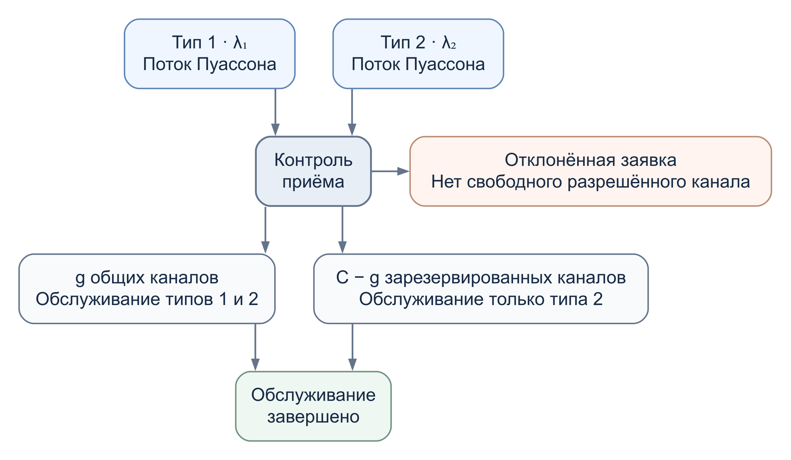
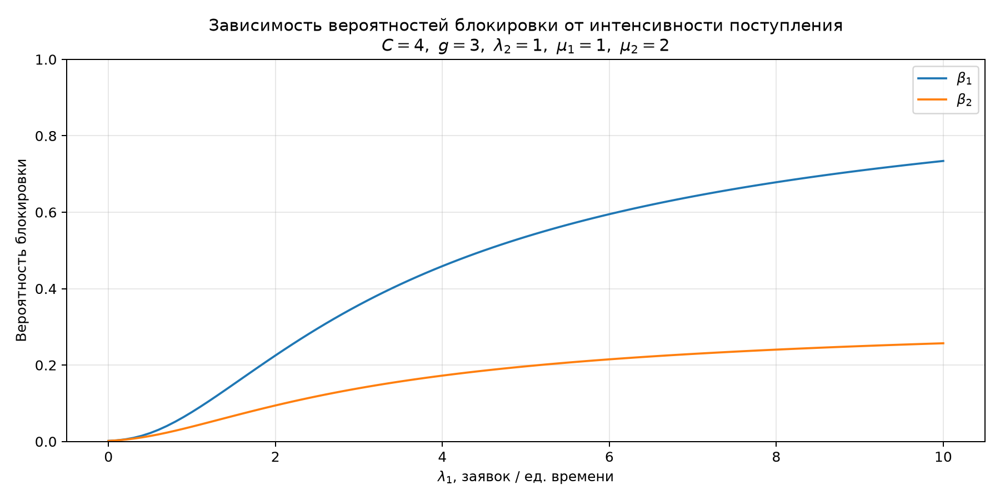
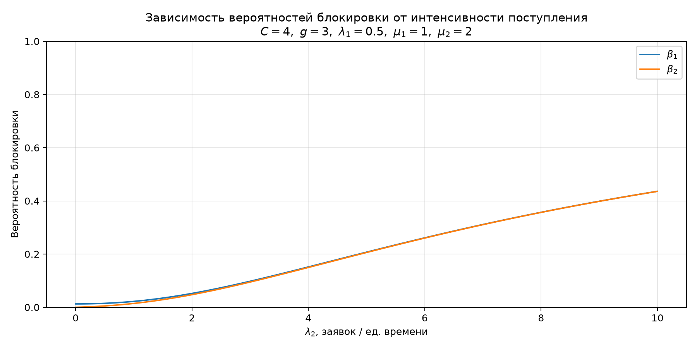
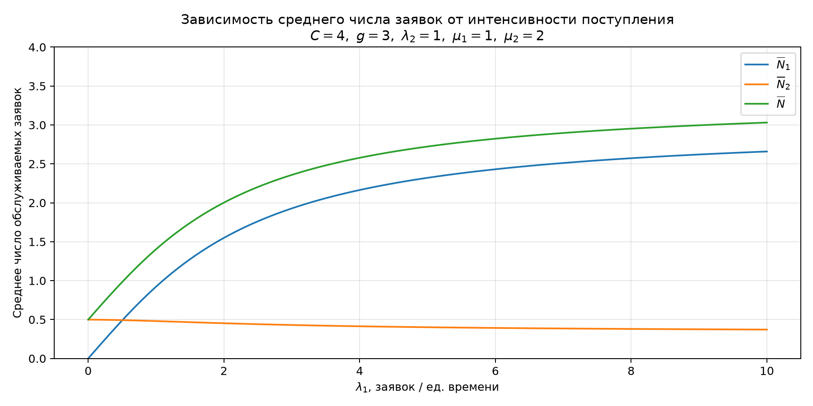
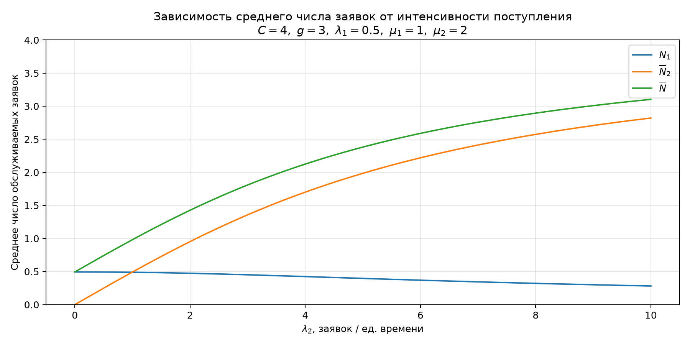

```{=latex}
\begin{titlepage}
\centering
\vspace*{30mm}
{\sffamily\bfseries\LARGE Отчет по лабораторной работе №1:\par}
\vspace{5mm}
{\sffamily\bfseries\Large Полнодоступная двухсервисная модель Эрланга с одинаковыми интенсивностями обслуживания\par}
\vspace{8mm}
{\sffamily\bfseries Дисциплина: Основы проектирования сетей и систем телекоммуникаций\par}
\vspace{15mm}
{\large Выполнил: Кхари Жекка Кализая Арсе, НПИбд-01-23\par}
\end{titlepage}
\tableofcontents
\clearpage

```

# Описание модели 

Modelo de Erlang de dos servicios con accesibilidad limitada y diferentes intensidades de servicio simula el comportamiento de un sistema que ofrese servicios para dos tipos de solicitudes, el sistema posee un numero limitado de canales ($C$) y cada solicitud llena un canal. ademas estos canales se dividen en 2 tipos, canales compartidos ($g$) y canales reservados ($C-g$). en nuestro modelo las solicitudes del tipo 1 solo pueden usar los canales compartidos, mientras que las solicitues del tipo 2 pueden usar tanto los canales compartidos como los reservados, ocupando primero los canales reservados y recurriendo a los compartidos cuando los reservados están llenos.  

## Схема модели


{#fig-esquema-modelo width=100% fig-pos=H}


## Определение пространства состояний


$$
\mathcal{X}=\left\{(n_1,n_2)\in\mathbb{Z}_{\geq 0}^{\,2}:
 n_1\leq g,\quad n_1+n_2\leq C\right\}.
$$

## Диаграмма интенсивностей переходов


<!-- Fuente editable: image/estados-general.tikz.
Regenerar desde lab04: xelatex -output-directory=image work/estados-general.tex -->

{#fig-estados-general width=98% fig-pos=H}

## Определить множества блокировок и приема.

Siguiendo el modelo dado, el conjunto de admisión para cada tipo de solicitud sería el siguiente:

$$
\begin{aligned}
S_1 &= \left\{(n_1,n_2)\in\mathcal{X}:
 n_1<g\;\land\;n_1+n_2<C\right\},\\[6pt]
S_2 &= \left\{(n_1,n_2)\in\mathcal{X}:
 n_1+n_2<C\right\}.
\end{aligned}
$$

Y el conjunto de bloqueo para cada tipo de solicitud sería el siguiente:

$$
\begin{aligned}
B_1 &= \left\{(n_1,n_2)\in\mathcal{X}:
 n_1=g\;\lor\;n_1+n_2=C\right\},\\[6pt]
B_2 &= \left\{(n_1,n_2)\in\mathcal{X}:
 n_1+n_2=C\right\}.
\end{aligned}
$$


## СУГБ, СУЛБ

Sea $p_{n_1,n_2}$ la probabilidad estacionaria del estado $(n_1,n_2)\in\mathcal X$.

Para representar la admisión de solicitudes, definimos:

$$
a_i(n_1,n_2)=
\begin{cases}
1,&(n_1,n_2)\in S_i,\\
0,&(n_1,n_2)\in B_i,
\end{cases}
\qquad i=1,2.
$$

El **sistema de ecuaciones de balance global (СУГБ)** se obtiene igualando los flujos totales de entrada y salida de cada estado:

$$
\begin{aligned}
&\left[
\lambda_1a_1(n_1,n_2)+\lambda_2a_2(n_1,n_2)
+n_1\mu_1+n_2\mu_2
\right]p_{n_1,n_2}\\
&\quad=
\lambda_1p_{n_1-1,n_2}
+\lambda_2p_{n_1,n_2-1}\\
&\qquad+
(n_1+1)\mu_1p_{n_1+1,n_2}
+(n_2+1)\mu_2p_{n_1,n_2+1},
\qquad (n_1,n_2)\in\mathcal X.
\end{aligned}
$$

Se considera $p_{n_1,n_2}=0$ cuando $(n_1,n_2)\notin\mathcal X$.

El **sistema de ecuaciones de balance local (СУЛБ)** iguala los flujos entre estados vecinos. Para las solicitudes de tipo 1:

$$
\lambda_1p_{n_1,n_2}
=(n_1+1)\mu_1p_{n_1+1,n_2},
\qquad (n_1,n_2)\in S_1.
$$

Para las solicitudes de tipo 2:

$$
\lambda_2p_{n_1,n_2}
=(n_2+1)\mu_2p_{n_1,n_2+1},
\qquad (n_1,n_2)\in S_2.
$$

Finalmente, las probabilidades deben satisfacer la condición de normalización y ser no negativas:

$$
\sum_{n_1=0}^{g}\sum_{n_2=0}^{C-n_1}p_{n_1,n_2}=1,
\qquad
p_{n_1,n_2}\geq0.
$$

## формулa для расчета распределения вероятностей.

$$
\rho_i=\frac{\lambda_i}{\mu_i},\qquad i=1,2.
$$

$$
\begin{aligned}
\lambda_1p_{n_1-1,n_2}
  &=n_1\mu_1p_{n_1,n_2},\qquad n_1\geq1,\\[4pt]
p_{n_1,n_2}
  &=\frac{\lambda_1}{n_1\mu_1}p_{n_1-1,n_2},\\[4pt]
p_{n_1,n_2}
  &=\frac{\rho_1}{n_1}p_{n_1-1,n_2},\\[4pt]
p_{n_1,n_2}
  &=\left(\prod_{k=1}^{n_1}\frac{\rho_1}{k}\right)p_{0,n_2},\\[4pt]
p_{n_1,n_2}
  &=\frac{\rho_1^{n_1}}{n_1!}p_{0,n_2}.
\end{aligned}
$$

$$
\begin{aligned}
\lambda_2p_{0,n_2-1}
  &=n_2\mu_2p_{0,n_2},\qquad n_2\geq1,\\[4pt]
p_{0,n_2}
  &=\frac{\lambda_2}{n_2\mu_2}p_{0,n_2-1},\\[4pt]
p_{0,n_2}
  &=\frac{\rho_2}{n_2}p_{0,n_2-1},\\[4pt]
p_{0,n_2}
  &=\left(\prod_{j=1}^{n_2}\frac{\rho_2}{j}\right)p_{0,0},\\[4pt]
p_{0,n_2}
  &=\frac{\rho_2^{n_2}}{n_2!}p_{0,0}.
\end{aligned}
$$

$$
\begin{aligned}
p_{n_1,n_2}
  &=\frac{\rho_1^{n_1}}{n_1!}p_{0,n_2},\\[4pt]
p_{n_1,n_2}
  &=\frac{\rho_1^{n_1}}{n_1!}
    \frac{\rho_2^{n_2}}{n_2!}p_{0,0}.
\end{aligned}
$$

$$
\begin{aligned}
1&=\sum_{n_1=0}^{g}\sum_{n_2=0}^{C-n_1}p_{n_1,n_2},\\[4pt]
1&=\sum_{n_1=0}^{g}\sum_{n_2=0}^{C-n_1}
  \frac{\rho_1^{n_1}\rho_2^{n_2}}{n_1!\,n_2!}p_{0,0},\\[4pt]
1&=p_{0,0}\sum_{n_1=0}^{g}\sum_{n_2=0}^{C-n_1}
  \frac{\rho_1^{n_1}\rho_2^{n_2}}{n_1!\,n_2!}.
\end{aligned}
$$

$$
G(C,g)=\sum_{k=0}^{g}\sum_{j=0}^{C-k}
\frac{\rho_1^k\rho_2^j}{k!\,j!}.
$$

$$
\begin{aligned}
p_{0,0}G(C,g)&=1,\\[4pt]
p_{0,0}&=\frac{1}{G(C,g)},\\[4pt]
p_{n_1,n_2}&=\frac{1}{G(C,g)}
  \frac{\rho_1^{n_1}\rho_2^{n_2}}{n_1!\,n_2!}.
\end{aligned}
$$

$$
\boxed{
p_{n_1,n_2}=
\frac{\displaystyle\frac{\rho_1^{n_1}\rho_2^{n_2}}{n_1!\,n_2!}}
     {\displaystyle\sum_{k=0}^{g}\sum_{j=0}^{C-k}
      \frac{\rho_1^k\rho_2^j}{k!\,j!}}
},\qquad(n_1,n_2)\in\mathcal X.
$$

## формулa для расчета вероятности блокировки заявки каждого типа.

Se denota por $\beta_i$ la probabilidad de bloqueo del tipo $i$.
Como las llegadas son de Poisson, esta probabilidad coincide con la
probabilidad estacionaria del conjunto $B_i$.

$$
B_1=\{(g,j):0\leq j\leq C-g\}
\cup\{(k,C-k):0\leq k<g\}.
$$

$$
\begin{aligned}
\beta_1
  &=\sum_{(n_1,n_2)\in B_1}p_{n_1,n_2},\\[6pt]
\beta_1
  &=\sum_{j=0}^{C-g}p_{g,j}
    +\sum_{k=0}^{g-1}p_{k,C-k},\\[6pt]
\beta_1
  &=p_{0,0}\sum_{j=0}^{C-g}\frac{\rho_1^g\rho_2^j}{g!\,j!}
    +p_{0,0}\sum_{k=0}^{g-1}
      \frac{\rho_1^k\rho_2^{C-k}}{k!\,(C-k)!},\\[6pt]
\beta_1
  &=p_{0,0}\left[
    \frac{\rho_1^g}{g!}\sum_{j=0}^{C-g}\frac{\rho_2^j}{j!}
    +\sum_{k=0}^{g-1}
      \frac{\rho_1^k\rho_2^{C-k}}{k!\,(C-k)!}
    \right].
\end{aligned}
$$

$$
\boxed{
\beta_1=\frac{1}{G(C,g)}\left[
  \frac{\rho_1^g}{g!}\sum_{j=0}^{C-g}\frac{\rho_2^j}{j!}
  +\sum_{k=0}^{g-1}
    \frac{\rho_1^k\rho_2^{C-k}}{k!\,(C-k)!}
\right]
}.
$$

$$
B_2=\{(k,C-k):0\leq k\leq g\}.
$$

$$
\begin{aligned}
\beta_2
  &=\sum_{(n_1,n_2)\in B_2}p_{n_1,n_2},\\[6pt]
\beta_2
  &=\sum_{k=0}^{g}p_{k,C-k},\\[6pt]
\beta_2
  &=\sum_{k=0}^{g}
    p_{0,0}\frac{\rho_1^k\rho_2^{C-k}}{k!\,(C-k)!},\\[6pt]
\beta_2
  &=p_{0,0}\sum_{k=0}^{g}
    \frac{\rho_1^k\rho_2^{C-k}}{k!\,(C-k)!}.
\end{aligned}
$$

$$
\boxed{
\beta_2=\frac{1}{G(C,g)}\sum_{k=0}^{g}
\frac{\rho_1^k\rho_2^{C-k}}{k!\,(C-k)!}
}.
$$

## формулa для расчета среднего числа обслуживаемых в системе заявок.

$$
\begin{aligned}
\overline N
  &=\mathbb E[N_1+N_2],\\[4pt]
\overline N
  &=\sum_{n_1=0}^{g}\sum_{n_2=0}^{C-n_1}
    (n_1+n_2)p_{n_1,n_2},\\[4pt]
\overline N
  &=\frac{1}{G(C,g)}
    \sum_{n_1=0}^{g}\sum_{n_2=0}^{C-n_1}
    (n_1+n_2)\frac{\rho_1^{n_1}\rho_2^{n_2}}{n_1!\,n_2!},\\[4pt]
\overline N
  &=\overline N_1+\overline N_2.
\end{aligned}
$$

$$
\begin{aligned}
\overline N_1
  &=\sum_{(n_1,n_2)\in\mathcal X}n_1p_{n_1,n_2},\\[5pt]
\overline N_1
  &=\sum_{\substack{(n_1,n_2)\in\mathcal X\\n_1\geq1}}
    n_1p_{n_1,n_2},\\[5pt]
\overline N_1
  &=\sum_{(k,j)\in S_1}(k+1)p_{k+1,j},\\[5pt]
\overline N_1
  &=\sum_{(k,j)\in S_1}\frac{\lambda_1}{\mu_1}p_{k,j},\\[5pt]
\overline N_1
  &=\rho_1\sum_{(k,j)\in S_1}p_{k,j},\\[5pt]
\overline N_1
  &=\rho_1\left(1-\sum_{(k,j)\in B_1}p_{k,j}\right),\\[5pt]
\overline N_1
  &=\rho_1(1-\beta_1).
\end{aligned}
$$

$$
\begin{aligned}
\overline N_2
  &=\sum_{(n_1,n_2)\in\mathcal X}n_2p_{n_1,n_2},\\[5pt]
\overline N_2
  &=\sum_{\substack{(n_1,n_2)\in\mathcal X\\n_2\geq1}}
    n_2p_{n_1,n_2},\\[5pt]
\overline N_2
  &=\sum_{(k,j)\in S_2}(j+1)p_{k,j+1},\\[5pt]
\overline N_2
  &=\sum_{(k,j)\in S_2}\frac{\lambda_2}{\mu_2}p_{k,j},\\[5pt]
\overline N_2
  &=\rho_2\sum_{(k,j)\in S_2}p_{k,j},\\[5pt]
\overline N_2
  &=\rho_2\left(1-\sum_{(k,j)\in B_2}p_{k,j}\right),\\[5pt]
\overline N_2
  &=\rho_2(1-\beta_2).
\end{aligned}
$$

$$
\begin{aligned}
\overline N
  &=\overline N_1+\overline N_2,\\[5pt]
\overline N
  &=\rho_1(1-\beta_1)+\rho_2(1-\beta_2),\\[5pt]
\overline N
  &=\frac{\lambda_1}{\mu_1}(1-\beta_1)
    +\frac{\lambda_2}{\mu_2}(1-\beta_2).
\end{aligned}
$$

$$
\boxed{\overline N=
\rho_1(1-\beta_1)+\rho_2(1-\beta_2)}.
$$

# Численный анализ

## Программа расчёта

Программа: `work/lab04.py`. Ноутбук: `work/lab04.ipynb`.

El programa acepta $C,g\in\mathbb Z_{\geq0}$, $g\leq C$,
$\lambda_i\geq0$ y $\mu_i>0$. Calcula todas las probabilidades
$p_{n_1,n_2}$, las probabilidades de bloqueo y las medias por tipo y total.
Los pesos se normalizan mediante logaritmos para evitar desbordamientos.

Desde `lab04`:

```bash
python -m pip install -r work/requirements.txt
python work/lab04.py
```

Desde `lab04/work` o desde el notebook también se puede utilizar directamente:

```python
from lab04 import Model
model = Model(C=4, g=3, lambda1=0.5, lambda2=1, mu1=1, mu2=2)
model.printTask10()
```



**Resultados del cálculo**

Para el cálculo numérico se utilizan:

$$
C=4,\quad g=3,\quad \lambda_1=0.5,\quad\lambda_2=1,
\quad\mu_1=1,\quad\mu_2=2.
$$

| $n_1$ | $n_2$ | $p_{n_1,n_2}$ |
|---:|---:|---:|
| 0 | 0 | 0.369586141 |
| 0 | 1 | 0.184793070 |
| 0 | 2 | 0.046198268 |
| 0 | 3 | 0.007699711 |
| 0 | 4 | 0.000962464 |
| 1 | 0 | 0.184793070 |
| 1 | 1 | 0.092396535 |
| 1 | 2 | 0.023099134 |
| 1 | 3 | 0.003849856 |
| 2 | 0 | 0.046198268 |
| 2 | 1 | 0.023099134 |
| 2 | 2 | 0.005774783 |
| 3 | 0 | 0.007699711 |
| 3 | 1 | 0.003849856 |

$$
\begin{aligned}
\sum_{(n_1,n_2)\in\mathcal X}p_{n_1,n_2}&=1,\\
\beta_1&=0.022136670,\qquad\beta_2=0.014436959,\\
\overline N_1&=0.488931665,\qquad\overline N_2=0.492781521,\\
\overline N&=0.981713186.
\end{aligned}
$$



## Вероятности блокировки

Se utilizan 101 puntos entre 0 y 10. En cada gráfica se modifica una
intensidad de llegada y se mantiene fija la otra. Las curvas se construyen
mediante `plt.plot`.

{#fig-blocking-lambda1 width=95% fig-pos=H}

{#fig-blocking-lambda2 width=95% fig-pos=H}



## Среднее число обслуживаемых заявок

Se representan las medias $\overline N_1$, $\overline N_2$ y
$\overline N=\overline N_1+\overline N_2$ bajo las mismas condiciones.

{#fig-mean-lambda1 width=95% fig-pos=H}


{#fig-mean-lambda2 width=95% fig-pos=H}
